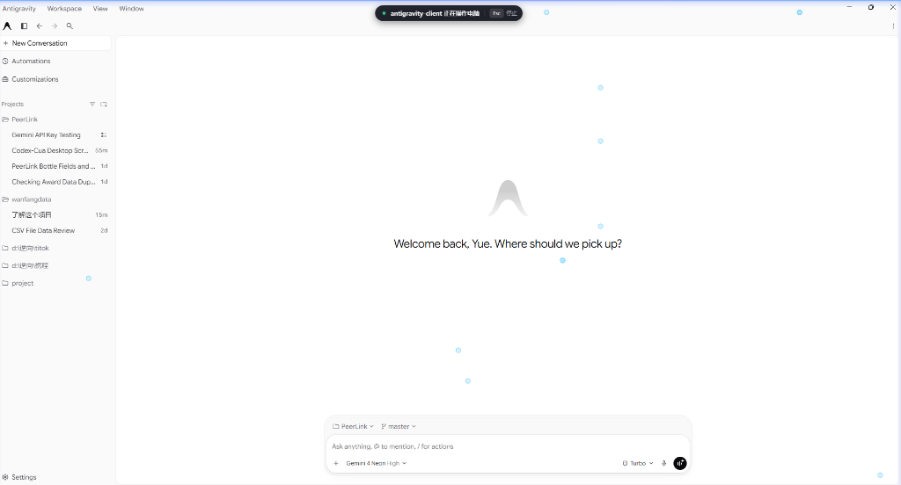

# codex-cua-mcp

> 把 OpenAI Codex 桌面端自带的 Windows 原生 Computer Use 能力，变成任何 AI 客户端都能直接调用的标准 MCP 服务。



如果你曾经羡慕 Codex 桌面端那种**丝滑、稳定、带屏幕光晕提示与 Esc 急停**的桌面操作体验，但平时又主力使用 **Claude Code、Antigravity、Cursor、Windsurf、Cline** 或其他支持 MCP 的 Harness——这个项目就是为此而生的。

它直接复用你电脑上已经安装好的 Codex 原生底层引擎（`codex-computer-use.exe` + 内置 `sharp`），补齐了 **Windows UI Automation 控件树直操、WPF 逐像素边缘光晕、平滑虚拟 AI 光标、点击涟漪波纹、物理 `Esc` 全局急停**，并且做到：

- **零 npm 依赖**：不用 `npm install` 一堆包
- **零 Python 依赖**：全部基于 Windows 原生 PowerShell + Node.js
- **零硬编码路径**：自动探测本机 Codex 安装位置，支持全局命令开箱即用

---

## 它能带来什么体验？

1. **看得见的 AI 操作（安全感拉满）**
   - AI 一开始接管桌面，屏幕四周会亮起柔和的蓝紫渐变光晕，顶部浮现毛玻璃状态条：`<客户端名> 正在操作电脑 | [Esc] 停止`（自动识别当前连接的 Harness 名称）。
   - 每次移动和点击，都能看到**虚拟 AI 指针平滑滑过去 + 落点扩散蓝青色波纹**，不再像盲盒一样不知道 AI 点了哪儿。
   - 觉得不对劲？**随时按一下物理 `Esc` 键**，遮罩瞬间消失，底层会话与批量动作立刻中断（且自动过滤 AI 自己发出的虚拟 `Esc` 按键，不会误触）。

2. **比纯截图流更快、更准**
   - **截图自动压缩**：复用 Codex 自带 `sharp` 做 mozjpeg 压缩（单张 1080p 截图体积缩小 ~70%），同时支持 `window_only: true` 单窗口裁剪。
   - **坐标零偏差**：每次截屏自动带回精确 `{ width, height, origin }`，所有坐标工具均支持 `normalized: true`（0–1000 归一化坐标自动换算）。
   - **能直操就不瞎猜**：内置常驻 Windows UI Automation 守护进程（`get_ui_tree`、`click_element`、`set_element_value`），可直接按控件名触发按钮和输入框。
   - **多步合一**：提供 `batch_actions` 与 Codex `node_repl` 同款 `run_js`，能把“打开应用 → 等窗口出现 → 连续点击输入 → 截图确认”压缩进一次调用。

---

## 环境要求

- **操作系统**：Windows 10 / 11
- **OpenAI Codex 桌面端**：已通过微软商店安装 `OpenAI.Codex`
- **Node.js**：>= 18（系统自带 PowerShell 5.1 即可，无需 Python）

---

## 10 秒快速安装

### 方式 A：一行命令从 GitHub 全局安装（最推荐）

```bash
npm install -g github:Azmyue/codex-cua
```

### 方式 B：克隆仓库后运行一键脚本

```powershell
git clone https://github.com/Azmyue/codex-cua.git
cd codex-cua
.\install.ps1
```

安装完成后，系统会注册全局命令 `codex-cua-mcp`，之后在任何 Harness 里都**不需要填写任何绝对路径**。

---

## 接入你的 Harness

### 1. 通用 JSON 配置（Antigravity / Claude Desktop / Cursor / Windsurf / Cline）

```json
{
  "mcpServers": {
    "codex-cua": {
      "command": "codex-cua-mcp"
    }
  }
}
```

### 2. Claude Code CLI

```bash
claude mcp add codex-cua -- codex-cua-mcp
```

### 3. Codex CLI / TOML 配置（`~/.codex/config.toml`）

```toml
[mcp_servers.codex-cua]
command = "codex-cua-mcp"
```

### 4. CC Switch 一键分发给所有客户端

在 CC Switch 左侧 **MCP** 页面新增一条 `stdio` 类型服务：
- **名称**：`codex-cua`
- **命令**：`codex-cua-mcp`
- **参数**：留空

勾选需要启用的客户端，就能一次性同步给本机所有 Harness。

> 如果不想全局安装，也可以把 `"command"` 改为 `"node"`，`"args"` 填 `["<仓库目录>/server.mjs"]`。

---

## 实战示例：让 AI 用 `codex-cua` 帮你操作桌面

装好并重启你的 AI 客户端后，直接用自然语言指挥它就行。下面给几个日常特别顺手的真实场景：

### 示例 1：让 `codex-cua` 帮我完成 CC Switch 的 MCP / 模型配置

> **你可以这样对 AI 说：**
> “用 `codex-cua` 打开我桌面上的 **CC Switch**，切到左侧的 **MCP** 页面，帮我新增一个名为 `codex-cua`、命令为 `codex-cua-mcp` 的 stdio 服务，然后勾选同步到 Claude Code 和 Cursor；点保存前先截一张图让我确认一下。”

**背后会自动发生什么：**
1. 屏幕四周亮起柔光边框，顶部弹出 `正在操作电脑 | [Esc] 停止`；
2. AI 先调用 `list_windows` / `activate_window`（或直接点击桌面/托盘图标）唤起 CC Switch；
3. 虚拟光标平滑移动到左侧 **MCP** 导航项并触发点击波纹，再点击「添加 MCP」；
4. 自动填入名称 `codex-cua`、类型 `stdio`、命令 `codex-cua-mcp`，勾选目标客户端；
5. 最后截取当前配置界面给你核对，等你确认后再点保存，完成后自动调用 `close_session` 收起边框。

### 示例 2：一键查询软件里的用量与账单

> **你可以这样对 AI 说：**
> “打开我的 CC Switch，进「用量统计」，筛选 Codex 看看最近 7 天消耗了多少钱和多少 Token，看完帮我关掉遮罩。”

AI 会自动唤起 CC Switch → 点击「用量统计」→ 切换 Codex 筛选器 → 读出屏幕上的总成本、请求数、Token 消耗与缓存命中率并整理成摘要回复你，全程无需你手动切窗口。

### 示例 3：组合多步自动化（配合安全护栏）

> **你可以这样对 AI 说：**
> “用 `codex-cua` 启动记事本，帮我整理一份今天的待办清单输进去，遇到保存或发送按钮先停下来问我。如果我想接管会直接按 Esc。”

---

## 暴露的 22 个 MCP 工具

| 分类 | 工具列表 | 说明 |
| :--- | :--- | :--- |
| **屏幕观察** | `get_screenshot` | 返回压缩 JPEG 及 `{ width, height, origin }`，支持 `window_only` / `hwnd` / `raw` |
| **鼠标控制** | `click`、`move`、`drag`、`drag_start`、`drag_move`、`drag_end`、`scroll` | 支持 `normalized: true`（0–1000 坐标）与 `screenshot_after: true` |
| **键盘与剪贴板** | `type_text`、`press_key`、`paste` | 支持 Unicode 输入、组合键（如 `Control+c` / `Alt+Tab`）与快速粘贴 |
| **UI 控件直操** | `get_ui_tree`、`click_element`、`set_element_value` | 基于 Windows UI Automation，按名称/AutomationId 直接点击或赋值 |
| **窗口与应用** | `list_windows`、`activate_window`、`wait_for_window`、`list_apps`、`launch_app` | 枚举窗口、置顶、轮询等待窗口出现、列出并启动应用 |
| **多步与会话** | `batch_actions`、`run_js`、`close_session` | 单回合批量执行或运行异步 JS 脚本；关闭会话并隐藏遮罩 |

---

## 可选环境变量

| 变量 | 默认值 | 说明 |
| :--- | :--- | :--- |
| `CODEX_CUA_OVERLAY_TEXT` | 自动读取客户端名 | 自定义顶部状态条文案 |
| `CODEX_CUA_NO_OVERLAY` | `0` | 设为 `1` 关闭边缘光晕与顶部提示条 |
| `CODEX_CUA_OVERLAY_IDLE_MS` | `30000` | 空闲多少毫秒后自动隐藏遮罩 |
| `CODEX_CUA_JPEG_QUALITY` | `55` | 截图 JPEG 压缩质量（1–100） |
| `CODEX_CUA_MAX_WIDTH` | `0`（原分辨率） | 可选限制截图最大宽度（如 `1280`） |
| `CODEX_SKY_CLIENT_PATH` | 自动探测并缓存至 `%TEMP%` | 手动指定 Codex `@oai/sky` 客户端路径 |

---

## 目录结构

```text
codex-cua/
├── server.mjs      # MCP stdio 主服务（22 个工具 + 四路预热 + sharp 压缩）
├── overlay.ps1     # WPF 边缘光晕 + 毛玻璃顶部胶囊 + 虚拟光标 + 点击波纹 + Esc 急停
├── win_tools.ps1   # 常驻 Windows 窗口管理与应用启动守护进程
├── uia_tree.ps1    # 常驻 Windows UI Automation 控件树与直操守护进程
├── install.ps1     # 一键环境检查与全局命令注册
├── package.json    # 标准 ESM 包与 bin 入口
└── README.md
```

## 常见问题

- **提示找不到 `OpenAI.Codex`？**
  请先通过微软商店安装并至少启动一次 OpenAI Codex 桌面端；若安装在非默认位置，可通过 `CODEX_SKY_CLIENT_PATH` 指定路径。
- **按 `Esc` 急停后下一轮怎么恢复？**
  急停冷却期为 5 秒（或调用一次 `close_session` 立即重置），之后下达新指令即可恢复正常。
- **不想每次都在提示词里写“用 `codex-cua`”？**
  在你的客户端全局规则（如 `GEMINI.md` / `CLAUDE.md`）里加上一句：“需要操作 Windows 桌面软件 GUI 时，优先调用 `codex-cua` MCP 工具，完成后调用 `close_session`。”
